# automatiza_aromatizador

Aromatizador automático baseado em **ESP8266 (ESP-01)** com ponte H **L298N**,
controlado por **interface web**. A eletrônica adapta um **aromatizador comercial
decorativo**, acionando seu motor para borrifar a fragrância em horários
programados. Projeto aberto a contribuições.

## Como funciona

Um celular ou PC acessa a interface web servida pelo próprio ESP-01, que mantém
data/hora pela internet (NTP), decide quando borrifar (respeitando horários,
dias e feriados) e aciona o motor do aromatizador através da ponte H L298N.

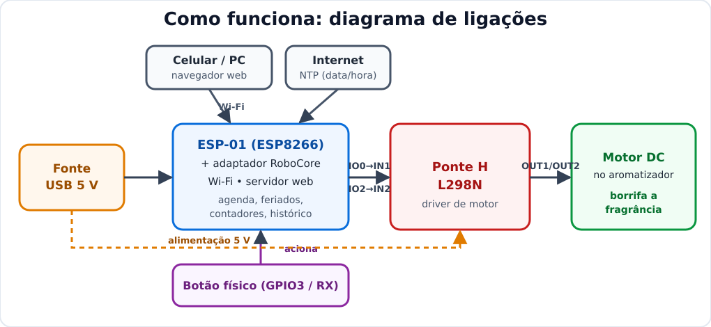

### Visão geral do protótipo
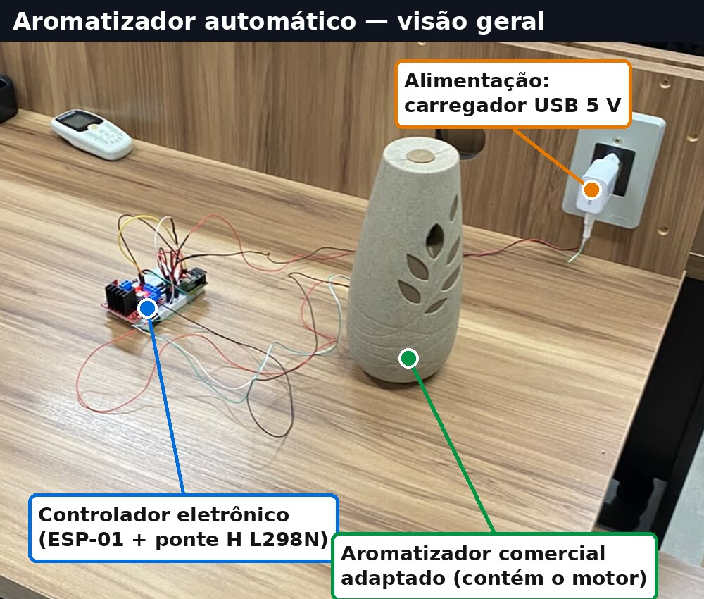

### Eletrônica: componentes principais
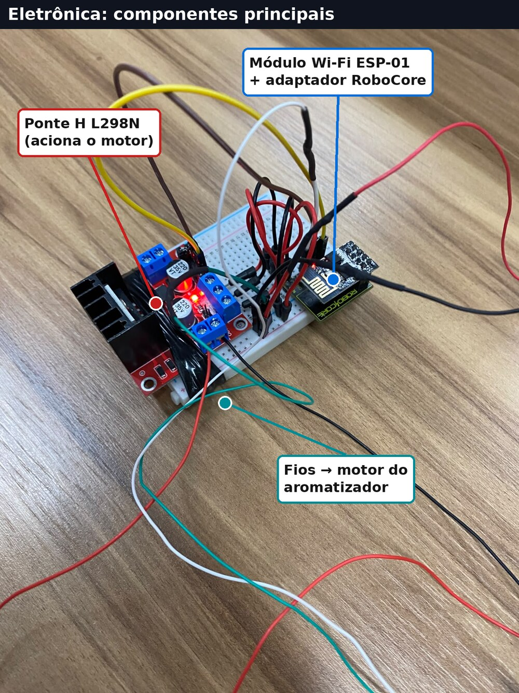

## Funcionalidades

- Acionamento **programado por horário** (intervalo configurável)
- **Bloqueios inteligentes**: horário, dia da semana, **feriados nacionais**
  (calculados no próprio ESP) e **lista de datas extras** (feriados municipais,
  emendas, férias)
- **Data e hora pela internet** (NTP, fuso de Brasília)
- **Interface web** para configuração e acompanhamento
- **Contadores** persistidos na flash (total, desde a troca do refil e por dia)
- **Histórico diário** com download em CSV
- Acesso via `http://aromatizador.local` (ou pelo IP no roteador)

## Lista de componentes (BOM)

| # | Componente | Qtd | Função |
|---|------------|-----|--------|
| 1 | **ESP-01 (ESP8266)** | 1 | Cérebro do sistema: Wi-Fi, servidor web, agenda, feriados, contadores |
| 2 | **Adaptador RoboCore para ESP-01** | 1 | Alimenta o ESP (regula 3,3 V), facilita gravação e as conexões |
| 3 | **Ponte H L298N** | 1 | Driver que aciona o motor do aromatizador |
| 4 | **Aromatizador comercial decorativo (com motor DC)** | 1 | Mecanismo que pressiona o refil e borrifa |
| 5 | **Refil aerossol / fragrância** | 1 | Consumível aromatizante |
| 6 | **Protoboard (breadboard)** | 1 | Montagem sem solda |
| 7 | **Jumpers / fios** | vários | Ligações entre os módulos |
| 8 | **Fonte USB 5 V (carregador) + cabo** | 1 | Alimentação do conjunto |

> As quantidades e modelos podem variar conforme a sua montagem. A regulação de
> tensão para o ESP (3,3 V) é feita pelo adaptador RoboCore, que aceita 5 V.

### Galeria dos componentes

<table>
  <tr>
    <td align="center" width="33%">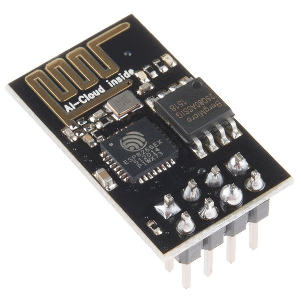 <b>ESP-01 (ESP8266)</b></td>
    <td align="center" width="33%">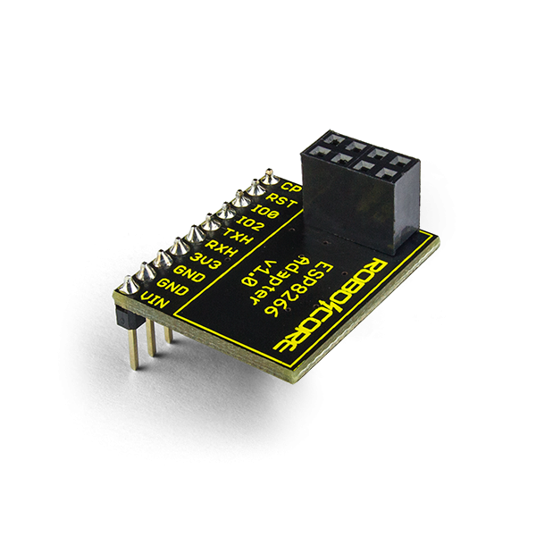 <b>Adaptador RoboCore</b></td>
    <td align="center" width="33%">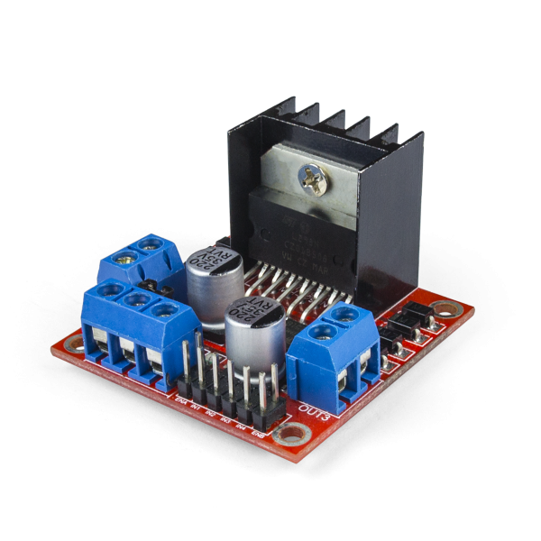 <b>Ponte H L298N</b></td>
  </tr>
  <tr>
    <td align="center">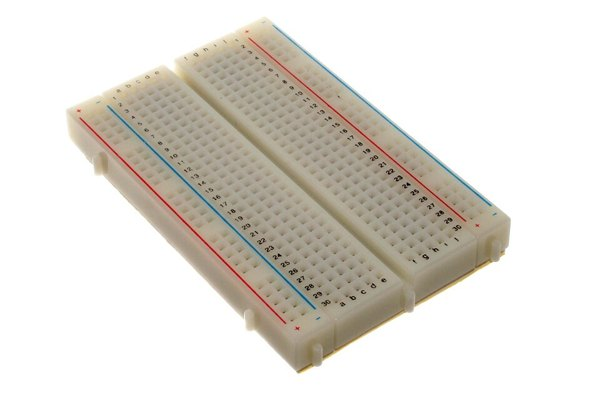 <b>Protoboard</b></td>
    <td align="center">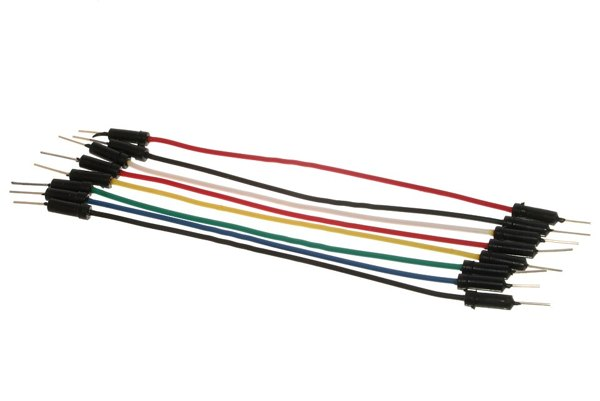 <b>Jumpers / fios</b></td>
    <td align="center">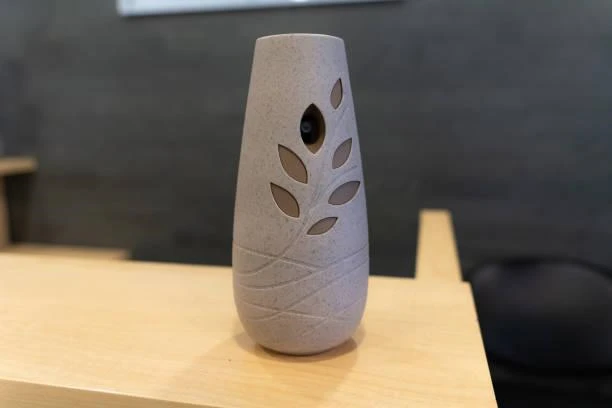 <b>Aromatizador</b></td>
  </tr>
</table>

> **ESP-01, protoboard e jumpers**: fotos de modelos equivalentes com licença livre
> (Wikimedia Commons; ver [Créditos](#créditos-das-imagens)). **Adaptador RoboCore,
> L298N e aromatizador**: imagens de fabricante/loja, de uso ilustrativo.

## Ligações (pinagem)

| ESP-01 | Destino |
|--------|---------|
| `IO0` | `IN1` da L298N |
| `IO2` | `IN2` da L298N |
| `RXH (GPIO3)` | Botão *Key* (outro fio no GND) |

Saídas `OUT1`/`OUT2` da L298N vão ao motor do aromatizador.

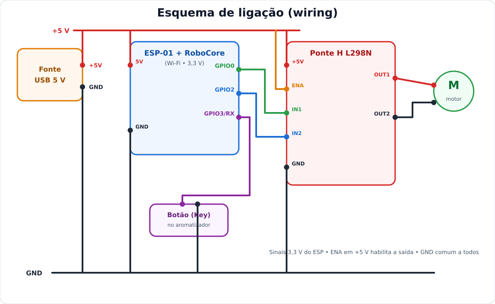

> Alimentação 5 V (USB) em um trilho comum; `GND` comum a todos os módulos;
> `ENA` em +5 V habilita a saída da ponte H.

### Variante em protoboard
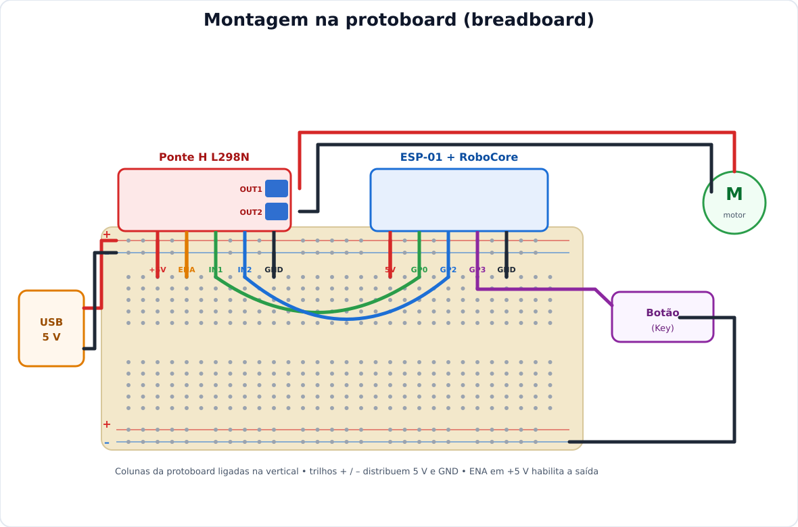

## Compilação (IDE Arduino)

- Placa: **Generic ESP8266 Module**
- Flash Size: **1MB (FS:64KB OTA:~470KB)**
- Sketch: [`aromatizador/aromatizador.ino`](aromatizador/aromatizador.ino)

## Configuração

Antes de compilar, ajuste as credenciais de Wi-Fi (`WIFI_NOME` / `WIFI_SENHA`)
no início do sketch. Os valores versionados são apenas placeholders
(`SUA_REDE_WIFI` / `SUA_SENHA_WIFI`). **Não** faça commit da sua senha real.

## Contribuindo

Sugestões e melhorias (especialmente na interface web) são bem-vindas via
_issues_ e _pull requests_. Veja o [`CONTRIBUTING.md`](CONTRIBUTING.md).

## Créditos das imagens

Parte das fotos de componentes vem do **Wikimedia Commons**, com **licença livre**,
e mantém a licença de seus autores (não são cobertas pela licença MIT deste projeto):

| Imagem | Autor | Licença | Fonte |
|--------|-------|---------|-------|
| `esp01.jpg` | Sparkfun Electronics | CC BY 2.0 | [Commons](https://commons.wikimedia.org/wiki/File:ESP-01.jpg) |
| `breadboard.jpg` | oomlout | CC BY-SA 2.0 | [Commons](https://commons.wikimedia.org/wiki/File:400_points_breadboard.jpg) |
| `jumpers.jpg` | oomlout | CC BY-SA 2.0 | [Commons](https://commons.wikimedia.org/wiki/File:A_few_Jumper_Wires.jpg) |

As imagens `adaptador-robocore.png`, `l298n.png` e `aromatizador.png` são **fotos de
fabricante/loja**, usadas aqui de forma **ilustrativa**; os direitos pertencem aos
respectivos titulares (não são do projeto nem da licença MIT).

As fotos de montagem, visão geral e eletrônica são de autoria do projeto.
© 2026 Marcos Morais.

## Licença

Código distribuído sob a licença **MIT**; veja [`LICENSE`](LICENSE).
© 2026 Marcos Morais. (As imagens de terceiros mantêm suas próprias licenças,
conforme a tabela acima.)
