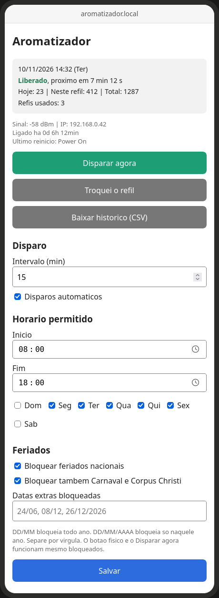
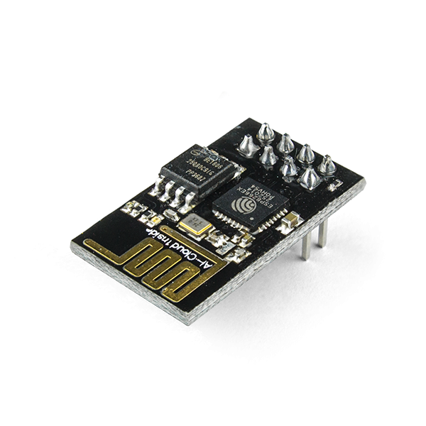
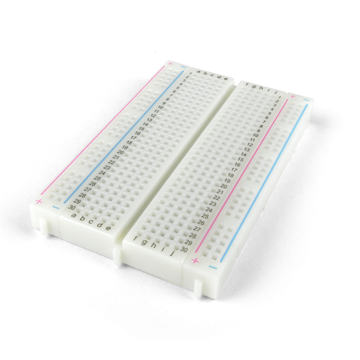
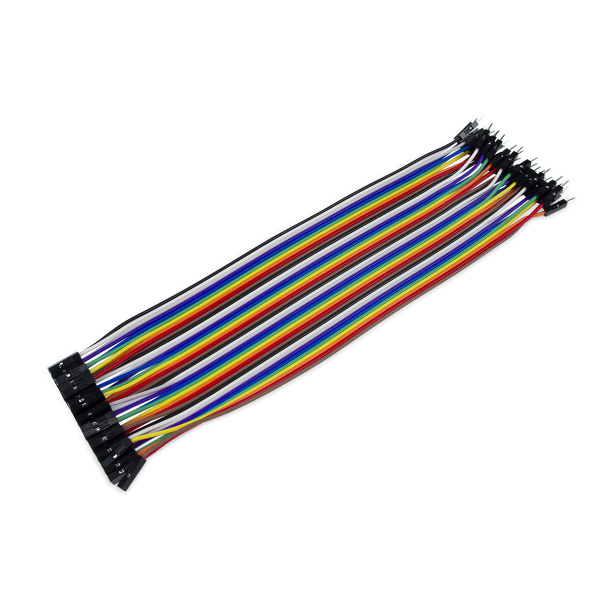
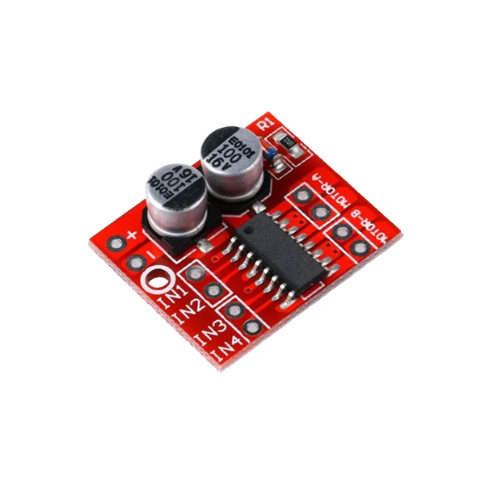

# automatiza_aromatizador

Aromatizador automático baseado em **ESP8266 (ESP-01)** com ponte H **L298N**,
controlado por **interface web**. A eletrônica adapta um **aromatizador comercial
decorativo**, acionando seu motor para borrifar a fragrância em horários
programados. Projeto aberto a contribuições.

## Como funciona

Um celular ou PC acessa a interface web servida pelo próprio ESP-01, que mantém
data/hora pela internet (NTP), decide quando borrifar (respeitando horários,
dias e feriados) e aciona o motor do aromatizador através da ponte H L298N.

### Visão geral do protótipo

### Eletrônica: componentes principais

## Funcionalidades

- Acionamento **programado por horário** (intervalo configurável)
- **Bloqueios inteligentes**: horário, dia da semana, **feriados nacionais**
  (calculados no próprio ESP) e **lista de datas extras** (feriados municipais,
  emendas, férias)
- **Data e hora pela internet** (NTP, fuso de Brasília)
- **Interface web** para configuração e acompanhamento
- **Contadores** persistidos na flash (total, desde a troca do refil e por dia)
- **Histórico diário** com download em CSV
- **Sem pilhas**: as baterias originais foram removidas e todo o conjunto é
  alimentado por um carregador de celular (USB 5 V) ligado à tomada, reduzindo o
  consumo de pilhas e a geração de lixo eletrônico
- Acesso via `http://aromatizador.local` (ou pelo IP no roteador)

## Interface web

Toda a configuração é feita por uma página servida pelo próprio ESP, acessível em
`http://aromatizador.local`. Por ela dá para disparar manualmente, registrar a
troca do refil, baixar o histórico em CSV e ajustar intervalo, horário permitido,
dias da semana, feriados e datas bloqueadas. O topo mostra data/hora, o status
(liberado ou bloqueado), o próximo disparo e os contadores (hoje, refil e total).

  

### Campos da tela

**Status (topo):** data, hora e dia da semana; indicação de `Liberado` ou
bloqueado; tempo para o próximo disparo; e os contadores **Hoje**, **Refil**
(desde a última troca) e **Total**.

**Ações:**
- `Disparar agora`: borrifa imediatamente (funciona mesmo fora do horário ou em dia bloqueado).
- `Troquei o refil`: zera o contador **Refil**.
- `Baixar histórico (CSV)`: baixa o histórico diário de disparos.

**Disparo** (um ciclo é a soma das três fases do motor):
- `Intervalo (min)`: minutos entre os disparos automáticos.
- `Desce (ms)`: tempo que o motor desce pressionando a válvula.
- `Pausa (ms)`: tempo parado com a válvula apertada, antes de inverter.
- `Volta (ms)`: tempo que o motor leva para voltar ao repouso.
- `Disparos automáticos`: liga ou desliga o ciclo automático (o botão físico e o `Disparar agora` continuam funcionando).

**Horário permitido:** `Início` e `Fim` do período em que os disparos automáticos
ocorrem, e os dias da semana ativos (Dom a Sáb).

**Feriados:**
- `Bloquear feriados nacionais`: não dispara nos feriados nacionais (calculados no próprio ESP).
- `Bloquear também Carnaval e Corpus Christi`.
- `Datas extras bloqueadas`: lista separada por vírgula. `DD/MM` bloqueia todo ano; `DD/MM/AAAA` bloqueia só naquele ano.

`Salvar` grava as configurações na memória flash.

## Lista de componentes (BOM)

| # | Componente | Qtd | Função |
|---|------------|-----|--------|
| 1 | **ESP-01 (ESP8266)** | 1 | Cérebro do sistema: Wi-Fi, servidor web, agenda, feriados, contadores |
| 2 | **Adaptador RoboCore para ESP-01** | 1 | Alimenta o ESP (regula 3,3 V), facilita gravação e as conexões |
| 3 | **Ponte H L298N** | 1 | Driver que aciona o motor do aromatizador |
| 4 | **Aromatizador comercial decorativo (com motor DC)** | 1 | Mecanismo que pressiona o refil e borrifa |
| 5 | **Refil aerossol / fragrância** | 1 | Consumível aromatizante |
| 6 | **Protoboard (breadboard)** | 1 | Montagem sem solda |
| 7 | **Jumpers / fios** | vários | Ligações entre os módulos |
| 8 | **Fonte USB 5 V (carregador) + cabo** | 1 | Alimentação do conjunto |

> As quantidades e modelos podem variar conforme a sua montagem. A regulação de
> tensão para o ESP (3,3 V) é feita pelo adaptador RoboCore, que aceita 5 V.

### Galeria dos componentes

<table>
  <tr>
    <td align="center" width="33%"> <b>ESP-01 (ESP8266)</b></td>
    <td align="center" width="33%"> <b>Adaptador RoboCore</b></td>
    <td align="center" width="33%"> <b>Ponte H L298N</b></td>
  </tr>
  <tr>
    <td align="center"> <b>Protoboard</b></td>
    <td align="center"> <b>Jumpers / fios</b></td>
    <td align="center"> <b>Aromatizador</b></td>
  </tr>
</table>

> As fotos dos componentes são imagens de fabricante/loja, de uso ilustrativo
> (ver [Créditos](#créditos-das-imagens)).

## Ligações (pinagem)

| ESP-01 | Destino |
|--------|---------|
| `IO0` | `IN1` da L298N |
| `IO2` | `IN2` da L298N |
| `RXH (GPIO3)` | Botão *Key* (outro fio no GND) |

Saídas `OUT1`/`OUT2` da L298N vão ao motor do aromatizador.

> Alimentação 5 V (USB) em um trilho comum; `GND` comum a todos os módulos;
> `ENA` em +5 V habilita a saída da ponte H.

### Variante em protoboard

## Compilação (IDE Arduino)

- Placa: **Generic ESP8266 Module**
- Flash Size: **1MB (FS:64KB OTA:~470KB)**
- Sketch: [`aromatizador/aromatizador.ino`](aromatizador/aromatizador.ino)

Para preparar a IDE Arduino e gravar o ESP8266 (instalação do core, seleção de
placa e gravação), veja o tutorial da RoboCore:
[Programando o ESP8266 pela Arduino IDE](https://www.robocore.net/tutoriais/programando-o-esp8266-pela-arduino-ide).

## Configuração

Antes de compilar, ajuste as credenciais de Wi-Fi (`WIFI_NOME` / `WIFI_SENHA`)
no início do sketch. Os valores versionados são apenas placeholders
(`SUA_REDE_WIFI` / `SUA_SENHA_WIFI`). **Não** faça commit da sua senha real.

## Próximos passos

Nas próximas versões, a ponte H L298N (grande) será substituída por um **driver
de motor menor** (ponte H compacta, como a da imagem abaixo). Com a eletrônica
reduzida, a ideia é **embutir todo o conjunto dentro do próprio aromatizador**,
deixando o produto final compacto e sem fios aparentes.

<table>
  <tr>
    <td align="center" width="40%"> <b>Mini ponte H (driver compacto)</b></td>
    <td>Substituirá a L298N, ocupando bem menos espaço e permitindo a montagem interna no aromatizador.</td>
  </tr>
</table>

## Contribuindo

Sugestões e melhorias (especialmente na interface web) são bem-vindas via
_issues_ e _pull requests_. Veja o [`CONTRIBUTING.md`](CONTRIBUTING.md).

## Créditos das imagens

As fotos da pasta `imagens/componentes/` (`esp01.png`, `adaptador-robocore.png`,
`l298n.png`, `breadboard.png`, `jumpers.png`, `aromatizador.png` e
`mini_ponte_H.png`) são **imagens de fabricante/loja**, usadas aqui de forma
**ilustrativa**; os direitos pertencem aos respectivos titulares (não são do
projeto nem da licença MIT).

As fotos de montagem, visão geral e eletrônica são de autoria do projeto.
© 2026 Marcos Morais.

## Licença

Código distribuído sob a licença **MIT**; veja [`LICENSE`](LICENSE).
© 2026 Marcos Morais. (As imagens de terceiros mantêm suas próprias licenças,
conforme a tabela acima.)
